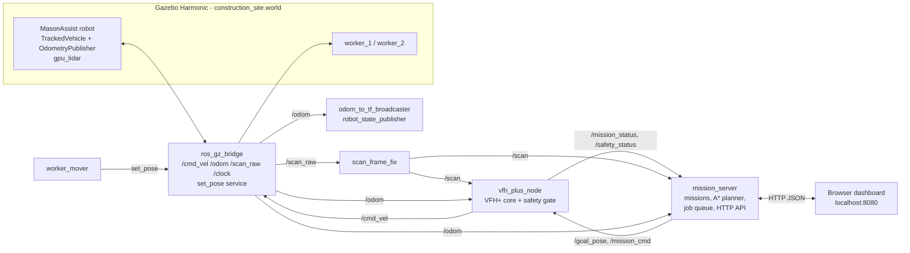

# MasonAssist

**An autonomous tracked material transporter for construction sites — simulated in ROS 2 Jazzy and Gazebo Harmonic.**

MasonAssist carries materials around a construction site: it drives to a storage area, "loads" bricks or blocks, delivers them to where they are needed, and returns to its dock — avoiding obstacles, slowing down and stopping for people, and reporting everything live to a web dashboard where an operator can queue jobs and intervene.

This is a **simulation project**. Nothing here has run on physical hardware.

---

## What it does

- **Transport missions** — multi-leg jobs such as *brick pickup → building door → dock*, with load/unload stops and payload tracking.
- **Job queue + history** — queue several deliveries; the robot runs them back to back. A failed or cancelled job pauses the queue until the operator resumes it.
- **Route planning** — A\* on the known site layout plans corner-safe waypoints for every leg and every map click.
- **Local obstacle avoidance** — a VFH+ (Vector Field Histogram Plus) controller drives between waypoints using live 360° LiDAR.
- **Human-aware safety** — LiDAR returns that are *not* part of the known site layout are treated as possible people or debris: the robot slows to 40 % within 2 m and stops within 1 m in its path, then resumes 1 s after the path clears.
- **Recovery and failure handling** — escape and rotate-in-place recovery; if a leg makes no progress for 45 s it is re-planned, and after 2 re-plans the mission fails cleanly with a reason.
- **Operator controls** — pause, resume, cancel, emergency stop. Clearing an e-stop leaves the robot *paused*: it never starts moving again on its own.
- **Live dashboard** — map with site layout, live LiDAR, trajectory, planned route and stations; mission, safety, queue and history panels; click the map to send the robot somewhere.
- **A living site** — two construction workers patrol their lanes and cross the robot's area.

---

## Architecture



**How a delivery works:** the operator queues a job in the dashboard → `mission_server` takes the next job, plans a route with A\* over the known layout (keeping 0.7 m from every known obstacle) and publishes one waypoint at a time on `/goal_pose` → `vfh_plus_node` steers toward the current waypoint with VFH+ on live LiDAR, while its safety gate limits speed near unmapped obstacles → `mission_server` advances the waypoint when the robot reaches it and marks a station reached only when odometry confirms the robot is there → load/unload, next leg, and finally back to the dock.

---

## Requirements

- Ubuntu 24.04
- ROS 2 Jazzy
- Gazebo Harmonic (gz-sim 8) with the ROS bridge: `ros-jazzy-ros-gz`
- `ros-jazzy-xacro`, `ros-jazzy-robot-state-publisher`, `ros-jazzy-joint-state-publisher`
- Python 3 with `numpy`
- A web browser

Developed and tested in a UTM ARM64 Ubuntu VM with software rendering (no GPU).

## Build

```bash
cd ~/Desktop/masonassist_ws          # or wherever you cloned it
source /opt/ros/jazzy/setup.bash
# optional, needs python3-rosdep (sudo rosdep init && rosdep update once):
rosdep install --from-paths src --ignore-src -y
colcon build --symlink-install
source install/setup.bash
```

## Run the demo

```bash
./start_demo.sh              # Gazebo 3D window + robot + workers + dashboard
./start_demo.sh --headless   # no Gazebo window (much faster in a VM; dashboard still shows everything)
./start_demo.sh --restart    # stop anything already running, then start
./stop_demo.sh               # stop everything cleanly
```

Then open **http://localhost:8080**.

`start_demo.sh` refuses to start if a stack is already running (avoids two controllers fighting over `/cmd_vel`). Logs go to `/tmp/masonassist_demo/`.

<details>
<summary>Running the pieces manually (three terminals)</summary>

```bash
# 1 - simulation + robot + navigation
source /opt/ros/jazzy/setup.bash && source install/setup.bash
ros2 launch masonassist_description gazebo.launch.py \
    world_file:=construction_site.world enable_vfh_plus:=true   # add headless:=true for no GUI

# 2 - moving workers
source /opt/ros/jazzy/setup.bash
python3 src/masonassist_description/scripts/worker_mover.py

# 3 - mission server + dashboard
source /opt/ros/jazzy/setup.bash
python3 src/masonassist_description/scripts/mission_server.py
```
</details>

---

## Using the dashboard

**Map (left)**
| Layer | Meaning |
|---|---|
| Grey boxes | Known site layout (the authored world geometry the planner uses) |
| Red dots | Live LiDAR returns |
| Orange dots | LiDAR returns not explained by the layout — possible person or debris |
| Cyan line | Trajectory from odometry |
| Dashed purple line | Planned A\* route for the current leg |
| Coloured squares | Stations: storage (orange), delivery (green), dock (grey) |
| Cyan triangle | The robot and its heading |

Click anywhere on the map to send the robot there. Points outside the site or inside an obstacle are rejected with the reason shown.

**Panel (right)**
- **Mission status** — `navigating`, `reached`, `blocked`, `recovering`, `stalled`, `yielding` (stopped for a person/obstacle), `paused`, `estopped`, `idle`.
- **Safety** — `CLEAR`, `SLOW (distance)`, `STOP - yielding (distance)`, and how many unmapped returns are visible.
- **Transport Missions** — `+ Queue …` buttons, the running job, waiting jobs (✕ to remove), Pause/Resume queue, Clear queue, and the current mission's legs, payload and elapsed time.
- **Job History** — every finished job with result, run time, re-plans and failure reason.
- **Mission Controls** — Pause / Resume / Cancel Mission / Emergency Stop / Clear E-Stop.

| Control | Effect |
|---|---|
| Pause / Resume | Robot holds position / continues the same leg |
| Cancel Mission | Aborts the current job; the queue pauses |
| Emergency Stop | Zero velocity immediately, held until cleared |
| Clear E-Stop | Robot stays **paused** — press Resume to move again |

---

## HTTP API

All endpoints are on `http://localhost:8080`.

| Method | Path | Body | Notes |
|---|---|---|---|
| GET | `/api/state` | | odom, scan, cmd_vel, mission_status, safety, goal, mission, queue |
| GET | `/api/layout` | | known obstacle boxes |
| GET | `/api/stations` | | stations and predefined missions |
| POST | `/api/queue` | `{"action":"add","mission":"bricks_to_building"}` | also `remove` (`id`), `clear`, `pause`, `resume`; 400 on bad input |
| POST | `/api/mission` | `{"mission":"blocks_to_scaffold"}` | start immediately; 409 if a mission is active |
| POST | `/api/goal` | `{"x":-3.0,"y":-3.0}` | planned trip to a point; 400 if outside the site or inside an obstacle |
| POST | `/api/cmd` | `{"cmd":"estop"}` | `pause`, `resume`, `cancel`, `estop`, `clear_estop` |

Example:
```bash
curl -X POST localhost:8080/api/queue -H 'Content-Type: application/json' \
     -d '{"action":"add","mission":"bricks_to_building"}'
```

## ROS interfaces

| Name | Type | Direction |
|---|---|---|
| `/scan` | `sensor_msgs/LaserScan` | `scan_frame_fix` → everyone (360° LiDAR, frame `laser_frame`) |
| `/odom` | `nav_msgs/Odometry` | Gazebo `OdometryPublisher` → bridge |
| `/cmd_vel` | `geometry_msgs/Twist` | `vfh_plus_node` → bridge → TrackedVehicle |
| `/goal_pose` | `geometry_msgs/Point` | `mission_server` → `vfh_plus_node` (one waypoint at a time) |
| `/mission_cmd` | `std_msgs/String` | `pause`, `resume`, `cancel`, `estop`, `clear_estop` |
| `/mission_status` | `std_msgs/String` | `vfh_plus_node` → `mission_server` |
| `/safety_status` | `std_msgs/String` (JSON) | `vfh_plus_node` → `mission_server` |
| `/world/masonassist_world/set_pose` | `ros_gz_interfaces/SetEntityPose` | `worker_mover` → Gazebo |

---

## Verified results

Measured in simulation in this repository's VM. These are small samples — they show the system working and repeatable, not statistical reliability.

**Repeatability** — 6 runs, each from a clean restart, robot starting at the dock, final position from Gazebo ground truth:

| Mission | Result | Time (s) | Final distance to dock |
|---|---|---|---|
| bricks_to_building | 3/3 complete | 166.0 / 166.6 / 168.2 | 0.28 m |
| blocks_to_scaffold | 3/3 complete | 184.0 / 186.4 / 185.8 | 0.29 m |

**Job queue** — 3 queued jobs ran back to back with no operator input (151.8 s, 162.6 s, 148.2 s, all complete). Cancelling a running job recorded it as aborted, paused the queue and stopped the robot; resuming started the next job, which completed from mid-site.

**Safety** — a person-sized obstacle placed 0.75 m in front of the moving robot: it stopped within one 0.5 s sample, held still while the obstacle stayed, and resumed automatically after it was removed. In normal missions, passing workers caused slow-downs only, with no false stops from known structures.

**Failure handling** — a goal sealed off by two temporary walls: re-planned at 46 s and 91 s, then the mission failed at 136 s with *"no progress toward goal after 2 replans"* and the robot stopped.

**Fixes found by measuring** — the TrackedVehicle plugin's own odometry drifted ~1.7 m / 35° after a minute of skid-steer turning (now replaced by `OdometryPublisher`); simulation speed went from 0.57× to 0.81× real time with the GUI and 0.99× headless after removing per-tick CLI process launches.

## Tests

```bash
source /opt/ros/jazzy/setup.bash && source install/setup.bash
python3 -m pytest src/masonassist_description/test/
```
145 tests covering the VFH+ core and node, LiDAR self-occlusion handling, safety zones, the A\* planner, the mission sequencer, the job queue and controller selection.

---

## Limitations

- **Simulation only** — no hardware testing.
- **Odometry is near-perfect** — it comes from Gazebo's `OdometryPublisher`, which follows the simulated motion. A real robot would need proper localization.
- **Planning uses an authored map** — the A\* planner knows the site layout as it was built into the world; there is no SLAM and no Nav2.
- **"Unmapped" is not person recognition** — anything not in the layout (a person, debris, a new pallet) triggers the safety zones the same way.
- **LiDAR self-occlusion mask** — two 9° bands where the robot's own tracks block the LiDAR are ignored. A very narrow obstacle that sits *only* inside those bands could go unseen; in that case the controller reports no data and stops rather than driving on.
- **Workers are teleported**, not physics-driven, so they can't be pushed by the robot.
- **Queue and history are in memory** and reset when the mission server restarts.
- **Gazebo's 3D window is CPU-heavy** with software rendering; use `--headless` on slow machines.

---

## Repository layout

```
start_demo.sh / stop_demo.sh            one-command demo start/stop
src/masonassist_description/
  launch/gazebo.launch.py               simulation, bridges, robot spawn, VFH+ node
  models/masonassist/model.sdf          robot model (tracks, LiDAR, odometry plugin)
  worlds/construction_site.world        construction site with stations and workers
  scripts/
    vfh_plus_core.py                    VFH+ algorithm (ROS-free)
    vfh_plus_node.py                    ROS controller: VFH+, recovery, escape, safety gate
    safety_zones.py                     human-aware slow/stop logic (ROS-free)
    site_planner.py                     A* route planner on the known layout (ROS-free)
    transport_mission.py                stations, missions, mission sequencer (ROS-free)
    job_queue.py                        job queue and history (ROS-free)
    mission_server.py                   ROS node + HTTP API + dashboard server
    dashboard.html                      the web dashboard
    worker_mover.py                     moves the construction workers; site obstacle list
    scan_frame_fix.py, odom_to_tf_broadcaster.py   LiDAR frame and TF helpers
  test/                                 pytest suite
HANDOFF.md                              original robot geometry, TF and propulsion validation notes
```
