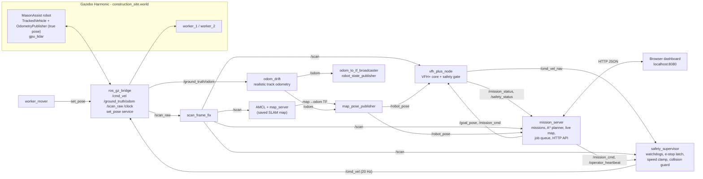
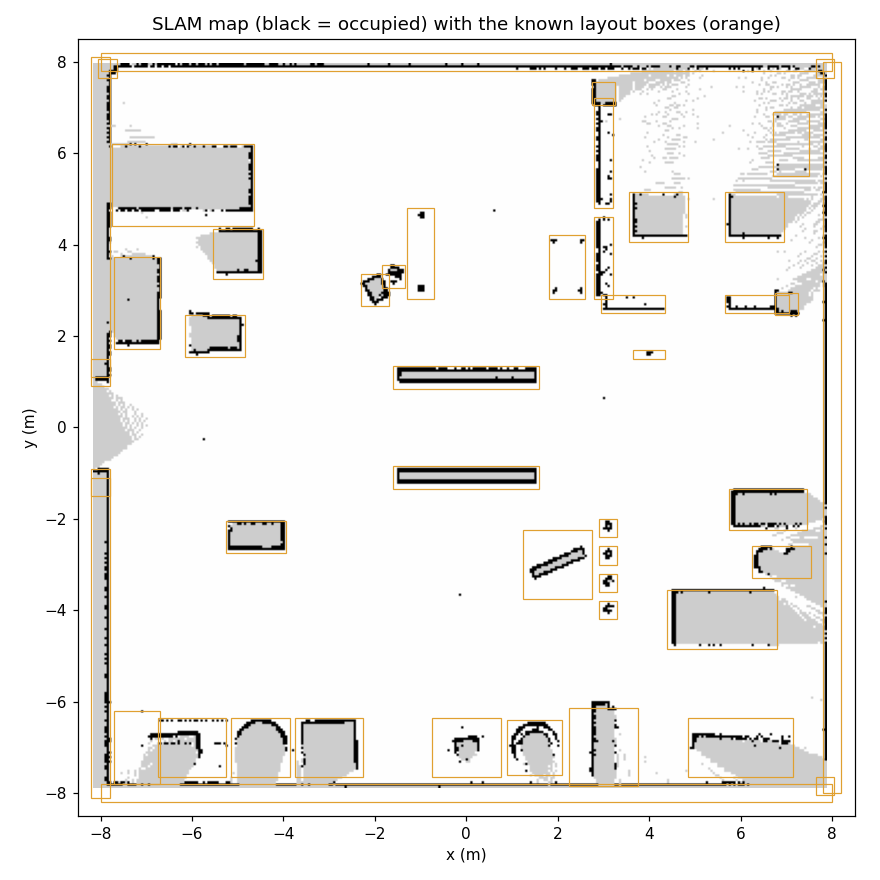
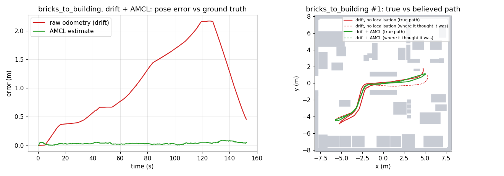
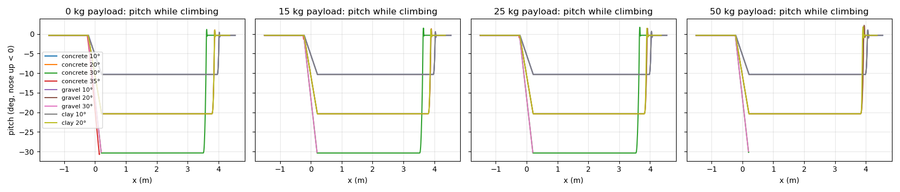
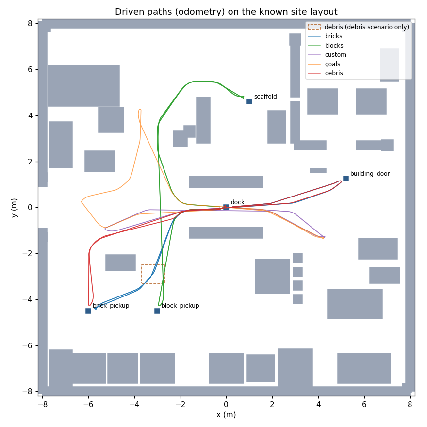

# MasonAssist

**An autonomous tracked material transporter for construction sites — simulated in ROS 2 Jazzy and Gazebo Harmonic.**

MasonAssist carries materials around a construction site: it drives to a storage area, "loads" bricks or blocks, delivers them to where they are needed, and returns to its dock — avoiding obstacles, slowing down and stopping for people, and reporting everything live to a web dashboard where an operator can queue jobs and intervene.

This is a **simulation project**. Nothing here has run on physical hardware.

---

## What it does

- **Transport missions** — multi-leg jobs such as *brick pickup → building door → dock*, with load/unload stops and payload tracking.
- **Job queue + history** — queue several deliveries; the robot runs them back to back. A failed or cancelled job pauses the queue until the operator resumes it.
- **Route planning** — A\* on the known site layout plans corner-safe waypoints for every leg and every map click.
- **Payload & terrain tested** — 0–50 kg loads on concrete, gravel and clay ramps up to 35° in simulation. Up to 25 kg it's unaffected; 50 kg tips on 30–35° slopes. The drive has realistic acceleration limits, and the tracks stop by themselves if commands stop arriving.
- **Localisation** — odometry drifts the way real track odometry does (slip on distance and turning). The robot localises with AMCL against a map of the site built with SLAM (slam_toolbox), so it stays within a few centimetres of its true position.
- **Live obstacle map** — obstacles the LiDAR sees that are not in the site layout (debris, a new pallet) and that stay put for 4 s are learned into an occupancy grid; the robot reroutes around them immediately, and they clear again once the LiDAR sees through the empty space.
- **Local obstacle avoidance** — a VFH+ (Vector Field Histogram Plus) controller drives between waypoints using live 360° LiDAR.
- **Human-aware safety** — LiDAR returns that are *not* part of the known site layout are treated as possible people or debris: the robot slows to 40 % within 2 m and stops within 1 m in its path, then resumes 1 s after the path clears.
- **Independent safety supervisor** — a separate node has the final say on every velocity command: it stops the robot if navigation, the LiDAR, odometry or the operator link goes silent, latches the e-stop, clamps speed, and blocks driving into anything at the body.
- **Recovery and failure handling** — escape and rotate-in-place recovery; if a leg makes no progress for 45 s it is re-planned, and after 2 re-plans the mission fails cleanly with a reason.
- **Operator controls** — pause, resume, cancel, emergency stop. Clearing an e-stop leaves the robot *paused*: it never starts moving again on its own.
- **Live dashboard** — map with site layout, live LiDAR, trajectory, planned route and stations; mission, safety, queue and history panels; click the map to send the robot somewhere.
- **A living site** — two construction workers patrol their lanes and cross the robot's area. The site has material storage (bricks, blocks, cement, pipes, timber, sand), a partly built building with delivered pallets inside, scaffolding, a site office, toilets, a concrete mixer, a water tank, a generator with fuel drums, a waste skip, a formwork stack beside the brick route, traffic cones around a work zone, and loading-bay markings at each station.

---

## Architecture



**How a delivery works:** the operator queues a job in the dashboard → `mission_server` takes the next job, plans a route with A\* over the known layout plus any learned obstacles (keeping 0.7 m from both) and publishes one waypoint at a time on `/goal_pose` → `vfh_plus_node` steers toward the current waypoint with VFH+ on live LiDAR, while its safety gate limits speed near unmapped obstacles → every second `mission_server` checks whether the remaining route now crosses a learned obstacle and, if so, reroutes → it advances the waypoint when the robot reaches it and marks a station reached only when odometry confirms the robot is there → load/unload, next leg, and finally back to the dock.

**Safety supervisor:** navigation never drives the robot directly. `vfh_plus_node` publishes `/cmd_vel_nav`; `safety_supervisor` is the only publisher of `/cmd_vel` and sends a command every 50 ms, zero unless all of these hold:

| Check | Stops with reason |
|---|---|
| E-stop pressed — latched; after Clear E-Stop still zero until Resume | `estop`, `hold_after_estop` |
| Mission cancelled — zero until a new goal | `cancelled` |
| `/scan` or `/odom` older than 0.5 s | `stale_scan`, `stale_odom` |
| Mission server heartbeat (`/operator_heartbeat`, 2 Hz) older than 2 s | `link_lost` |
| Navigation command older than 0.3 s (node hung or crashed) | `stale_cmd` |

Command and sensor ages are measured in **sim time** (which is wall time on a real robot), with a 1.0 s wall-clock backstop. With the Gazebo window open, the simulation itself sometimes pauses, for up to 0.82 s of wall time in which only ~0.12 s of sim time passes. The robot can't move during those pauses, so they don't count as stale. Judged in wall time, they caused up to 11 false stops per mission.
| LiDAR return within 0.15 m of the body in the direction of travel — rotation still allowed | `collision_guard` |

Speeds above 0.25 m/s / 0.5 rad/s are clamped. It runs separately from navigation, with its own rules in `safety_supervisor_core.py`, so a hung, crashed or misbehaving navigation node can't keep the robot moving.

---

## Requirements

- Ubuntu 24.04
- ROS 2 Jazzy
- Gazebo Harmonic (gz-sim 8) with the ROS bridge: `ros-jazzy-ros-gz`
- `ros-jazzy-xacro`, `ros-jazzy-robot-state-publisher`, `ros-jazzy-joint-state-publisher`
- Python 3 with `numpy`
- A web browser

Developed and tested in a UTM ARM64 Ubuntu VM with software rendering (no GPU).

## Build

```bash
cd ~/Desktop/masonassist_ws          # or wherever you cloned it
source /opt/ros/jazzy/setup.bash
# optional, needs python3-rosdep (sudo rosdep init && rosdep update once):
rosdep install --from-paths src --ignore-src -y
colcon build --symlink-install
source install/setup.bash
```

## Run the demo

```bash
./start_demo.sh              # Gazebo 3D window + robot + workers + dashboard
./start_demo.sh --headless   # no Gazebo window (much faster in a VM; dashboard still shows everything)
./start_demo.sh --restart    # stop anything already running, then start
# defaults: drifting odometry + AMCL localisation on the saved map. Other options:
./start_demo.sh --odometry=perfect --localization=none   # robot uses the simulator's true pose
./start_demo.sh --localization=none                      # drifting odometry, no localisation (it gets lost)
./stop_demo.sh               # stop everything cleanly
```

Then open **http://localhost:8080**.

`start_demo.sh` refuses to start if a stack is already running (avoids two controllers fighting over `/cmd_vel`). After startup it waits 5 s and checks that every component is still running and that odometry, LiDAR, supervisor and navigation status are all flowing. If anything is missing it names it, stops the partly started stack and exits with an error. Logs go to `/tmp/masonassist_demo/`.

<details>
<summary>Running the pieces manually (three terminals)</summary>

```bash
# 1 - simulation + robot + navigation
source /opt/ros/jazzy/setup.bash && source install/setup.bash
ros2 launch masonassist_description gazebo.launch.py \
    world_file:=construction_site.world enable_vfh_plus:=true   # add headless:=true for no GUI

# 2 - moving workers
source /opt/ros/jazzy/setup.bash
python3 src/masonassist_description/scripts/worker_mover.py

# 3 - mission server + dashboard
source /opt/ros/jazzy/setup.bash
python3 src/masonassist_description/scripts/mission_server.py
```
</details>

---

## Using the dashboard

**Map (left)**
| Layer | Meaning |
|---|---|
| Grey boxes | Known site layout (the authored world geometry the planner uses) |
| Red dots | Live LiDAR returns |
| Orange dots | LiDAR returns not explained by the layout — possible person or debris |
| Cyan line | Trajectory from odometry |
| Dashed purple line | Planned A\* route for the current leg |
| Dark-orange squares | Learned obstacles (live map) |
| Coloured squares | Stations: storage (orange), delivery (green), dock (grey) |
| Cyan triangle | The robot and its heading |

Click anywhere on the map to send the robot there. Points outside the site or inside an obstacle are rejected with the reason shown.

**Panel (right)**
- **Mission status** — `navigating`, `reached`, `blocked`, `recovering`, `stalled`, `yielding` (stopped for a person/obstacle), `paused`, `estopped`, `idle`.
- **Safety supervisor** — `OK`, or why it's holding the robot (e-stop, hold, cancelled, stale LiDAR/odometry, operator link lost, obstacle at body), and whether speed is being clamped. `not running` if its status stops arriving.
- **Velocity** — what navigation asked for (`/cmd_vel_nav`) next to what was sent to the robot (`/cmd_vel`).
- **Safety** — `CLEAR`, `SLOW (distance)`, `STOP - yielding (distance)`, and how many unmapped returns are visible.
- **Transport Missions** — `+ Queue …` buttons for the two fixed jobs, plus a **Custom job**: pick a pick-up and a drop-off from the station lists, or choose *point on map…* and click the map (a P / D marker shows the point), then **+ Queue custom job**. The robot loads at the pick-up, unloads at the drop-off and returns to the dock. A job is rejected with the reason if a point is outside the site, inside an obstacle or unreachable, or if pick-up and drop-off are the same place. Also: the running job, waiting jobs (✕ to remove), Pause/Resume queue, Clear queue, and the current mission's legs, payload and elapsed time.
- **Job History** — every finished job with result, run time, re-plans and failure reason.
- **Mission Controls** — Pause / Resume / Cancel Mission / Emergency Stop / Clear E-Stop.

| Control | Effect |
|---|---|
| Pause / Resume | Robot holds position / continues the same leg |
| Cancel Mission | Aborts the current job; the queue pauses |
| Emergency Stop | Zero velocity immediately, held until cleared |
| Clear E-Stop | Robot stays **paused** — press Resume to move again |

---

## HTTP API

All endpoints are on `http://localhost:8080`.

| Method | Path | Body | Notes |
|---|---|---|---|
| GET | `/api/state` | | odom, scan, cmd_vel, mission_status, safety, goal, mission, queue |
| GET | `/api/layout` | | known obstacle boxes |
| GET | `/api/stations` | | stations and predefined missions |
| POST | `/api/queue` | `{"action":"add","mission":"bricks_to_building"}` | also `remove` (`id`), `clear`, `pause`, `resume`; 400 on bad input |
| POST | `/api/queue` | `{"action":"add","mission":"custom","pickup":"block_pickup","dropoff":{"x":-5.5,"y":-1.0}}` | custom job; `pickup` / `dropoff` = station name or `{"x","y"}`; 400 with the reason if it can't be run |
| POST | `/api/mission` | `{"mission":"blocks_to_scaffold"}` | start immediately; 409 if a mission is active |
| POST | `/api/goal` | `{"x":-3.0,"y":-3.0}` | planned trip to a point; 400 if outside the site or inside an obstacle |
| POST | `/api/cmd` | `{"cmd":"estop"}` | `pause`, `resume`, `cancel`, `estop`, `clear_estop`, `clear_map` (forget learned obstacles) |

Example:
```bash
curl -X POST localhost:8080/api/queue -H 'Content-Type: application/json' \
     -d '{"action":"add","mission":"bricks_to_building"}'
```

Custom job from a point to a station:
```bash
curl -X POST localhost:8080/api/queue -H 'Content-Type: application/json' \
     -d '{"action":"add","mission":"custom","pickup":{"x":4.5,"y":-1.5},"dropoff":"scaffold"}'
```

## ROS interfaces

| Name | Type | Direction |
|---|---|---|
| `/scan` | `sensor_msgs/LaserScan` | `scan_frame_fix` → everyone (360° LiDAR, frame `laser_frame`) |
| `/ground_truth/odom` | `nav_msgs/Odometry` | Gazebo `OdometryPublisher` (true pose) → `odom_drift`; also read by evaluation and the dashboard's "true pose" marker |
| `/odom` | `nav_msgs/Odometry` | `odom_drift` → TF `odom→base_footprint`, AMCL, supervisor |
| `/map` | `nav_msgs/OccupancyGrid` | `map_server` (saved SLAM map) → AMCL |
| `/robot_pose` | `nav_msgs/Odometry` (frame `map`) | `map_pose_publisher` (AMCL's `map→odom` + `/odom`) → `vfh_plus_node`, `mission_server` |
| `/cmd_vel_nav` | `geometry_msgs/Twist` | `vfh_plus_node` → `safety_supervisor` |
| `/cmd_vel` | `geometry_msgs/Twist` | `safety_supervisor` → bridge → TrackedVehicle (20 Hz, always) |
| `/operator_heartbeat` | `std_msgs/String` | `mission_server` → `safety_supervisor` (2 Hz) |
| `/supervisor_status` | `std_msgs/String` (JSON) | `safety_supervisor` → `mission_server`: `reason`, `clamped`, `front_clear_m` |
| `/goal_pose` | `geometry_msgs/Point` | `mission_server` → `vfh_plus_node` (one waypoint at a time) |
| `/mission_cmd` | `std_msgs/String` | `pause`, `resume`, `cancel`, `estop`, `clear_estop` (read by `vfh_plus_node` and `safety_supervisor`) |
| `/mission_status` | `std_msgs/String` | `vfh_plus_node` → `mission_server` |
| `/safety_status` | `std_msgs/String` (JSON) | `vfh_plus_node` → `mission_server` |
| `/world/masonassist_world/set_pose` | `ros_gz_interfaces/SetEntityPose` | `worker_mover` → Gazebo |

---

## Verified results

Measured in simulation in this repository's VM. These are small samples — they show the system working and repeatable, not statistical reliability.

### Localisation: SLAM map + AMCL vs drifting odometry

Real track odometry drifts: tracks slip, and skid-steer turning slips a lot. In simulation the robot's `/odom` comes from `odom_drift`, which adds that kind of error to the simulator's true motion:
- +3 % on distance;
- +6 % on turning;
- a heading bias that slowly wanders, seeded so runs are repeatable.

Over a mission that adds up to 1–6 m of error. The robot localises against a map of the site, built once with SLAM, using AMCL.

**Map** (`tools/build_map.py`):
- slam_toolbox built the map from a 76 m coverage tour driven on drifting odometry, with the workers moved off site so people aren't mapped.
- During the tour, raw odometry was off by up to 6.7 m (mean 2.9 m); the SLAM pose was off by at most 0.088 m (mean 0.021 m).
- 99.9 % of the occupied map cells lie on known objects, and 68.6 % of the object outlines were mapped. The misses are the far corner column, the thin safety-tape posts and objects below the LiDAR's 0.27 m scan height.
- The map is in `maps/construction_site.{yaml,pgm}`.



**Three-way comparison:** the same scenarios (bricks ×2, blocks ×2, 5-goal tour ×2), each from a clean restart. Data: [`docs/localization/runs.csv`](docs/localization/runs.csv).

| Setup | Success | Pose error vs truth (mean / max) | Raw odometry drift (max) | Closest body clearance | Time vs perfect |
|---|---|---|---|---|---|
| Perfect odometry (simulator truth) | 6/6 | 0.000 / 0.009 m | — | 0.094 m | — |
| Drifting odometry, **no** localisation | **0/6** | 0.31–1.43 / 1.83 m | 1.83 m | **0.0 m** (contact) | — |
| Drifting odometry **+ AMCL** (default) | **6/6** | **0.022–0.037 / 0.090 m** | 4.17 m | 0.101 m | +0 to +3 s |

Without localisation:
- every job failed: "no route", "no progress after 2 replans", or a timeout;
- the robot touched obstacles;
- it learned up to 204 cells of phantom obstacles, because it saw the real walls where its drifted pose said there should be none.

With AMCL, every job completed with the same paths and times as perfect odometry.



```bash
python3 tools/eval_navigation.py --scenarios bricks,blocks,goals --reps 2 --odometry drift --localization amcl
python3 tools/eval_navigation.py ... --odometry drift --localization none     # to see it fail
python3 tools/build_map.py                                                    # rebuild the map
```

### Payload & terrain (simulation)

`tools/terrain_test.py` loads the robot with 0 / 15 / 25 / 50 kg and drives it on a test world of ramps.
- **Payload:** a pallet of bricks fixed on the deck, `--payload=KG` in `start_demo.sh`. Its height follows its mass, so a heavier load also raises the centre of gravity.
- **Ramps:** concrete (μ 1.0) at 10° / 20° / 30° / 35°, gravel (μ 0.6) at 10° / 20° / 30°, and wet clay (μ 0.4) at 10° / 20°, plus a 10° side slope.
- **Driving:** commands go straight to the tracks (no navigation or supervisor), at 0.2–0.25 m/s, with the drive's 0.5 m/s² acceleration limit.

Full tables: [`docs/terrain/summary.md`](docs/terrain/summary.md); data: [`results.csv`](docs/terrain/results.csv).

| | 0 kg | 15 kg | 25 kg | 50 kg |
|---|---|---|---|---|
| Climb from level ground | 10–30° concrete, 10–20° gravel and clay | same | same | 10–20° only |
| Hold and hill start, placed on the slope | all slopes up to 35°, no slide | same | same | **tipped over on 35°** |
| Downhill stop from 0.25 m/s | 0.07 m; 0.10 m on 20° clay; 0.18 m on 30° gravel | same | same | 0.07 m up to 20°; **1.3 m slide on 30° gravel; tipped over on 30° and 35° concrete** |
| Flat stop from 0.25 m/s | 0.067 m | 0.076 m | 0.065 m | 0.075 m |
| 10° side slope | stable, no sideways drift | same | same | same |

What the results show:
- **Up to 25 kg the robot is unaffected.** It handled every slope up to 30° on concrete and up to 20° on gravel and clay, with no slip, no slide-back and 7–10 cm stopping distances.
- **50 kg is the limit case.** The load's centre sits about 0.43 m above the ground. Braking down a 30° slope, or simply standing on 35°, tipped the robot over (pitch about 90°). On 30° gravel it slid 1.3 m before stopping.
- **Operating limit taken from these results:** with a 50 kg load, stay on slopes of 20° or less. Empty or at 25 kg, up to 30° on concrete. The robot has no tilt sensor yet, so this is a site rule, not something it enforces itself (see Limitations).
- **Approach corners:** climbs from level ground onto 35° concrete and 30° gravel stalled at the sharp corner where the ground meets the ramp, even empty. Placed directly on those slopes, it held and drove up. That's an approach-geometry limit, not a grip limit.
- **This is a rough model.** It uses Coulomb friction, where weight cancels out of grip, which is why payload mostly matters through tipping. Real tracks on soil also sink and shear, and real motors have torque limits. Read these numbers as relative, not absolute.



```bash
python3 tools/terrain_test.py                                   # full matrix, ~80 min
python3 tools/terrain_test.py --payloads 0 --lanes concrete_10  # quick check
./start_demo.sh --payload=25                                    # run the demo loaded
```

### Navigation evaluation (reproducible)

One command runs every scenario repeatedly, each from a clean restart with the robot at the dock, and writes `runs.csv` (one row per run), a trace per run, `summary.md` and a path plot:

```bash
python3 tools/eval_navigation.py                              # default set: 11 runs, ~45 min headless
python3 tools/eval_navigation.py --scenarios bricks --reps 1  # quick check
python3 tools/eval_navigation.py --gui                        # with the Gazebo window (slower)
```

Output goes to `eval_results/<timestamp>/`. The reference run below is committed in [`docs/eval/`](docs/eval/) ([summary](docs/eval/summary.md), [CSV](docs/eval/runs.csv)).

| Scenario | Success | Time (s) | Driven (m) | Path ratio | Min body clearance (m) | Max arrival error (m) | Reroutes | Supervisor stops |
|---|---|---|---|---|---|---|---|---|
| bricks_to_building | 3/3 | 151.7 ± 0.4 | 26.23 | 0.94 | 0.093 | 0.287 | 0 | 0 |
| blocks_to_scaffold | 3/3 | 165.9 ± 1.5 | 29.42 | 0.96 | 0.218 | 0.289 | 0 | 0 |
| custom job (map point → map point) | 2/2 | 114.2 ± 0.7 | 19.94 | 0.94 | 0.257 | 0.286 | 0 | 0 |
| 5 chained map-click goals | 1/1 | 157.1 | 28.12 | 0.95 | 0.101 | 0.293 | 0 | 0 |
| bricks + unmapped box dropped on the route | 2/2 | 162.0 ± 0.6 | 27.91 | 1.00 | 0.089 | 0.293 | 1 each | 0 |



What the columns mean:
- **Path ratio:** distance driven ÷ shortest planned route. Just under 1 is normal, since the robot cuts waypoint corners and stops within 0.35 m of each station. The debris runs drive about 6 % further for the detour.
- **Body clearance:** the smallest gap between the robot's footprint and any obstacle's collision box. The closest pass, about 0.09 m, is the warning sign beside the building door. Its collision box is a 0.6 m-wide panel down to the ground, although the visible part at robot height is a 4 cm post.
- **Odometry:** this reference run used perfect odometry (the simulator's true pose), from before localisation was added. The localisation comparison above repeats these scenarios with drifting odometry and AMCL.
- **Debris:** both debris runs learned the box (26 and 27 cells), rerouted once and completed.
- **Supervisor:** it never had to override navigation in these runs.
- **Mission times** are about 15 s shorter than the older single runs below. Those had extra per-second `gz` logging that slowed the simulator.

**Repeatability** — 6 runs, each from a clean restart, robot starting at the dock, final position from Gazebo ground truth:

| Mission | Result | Time (s) | Final distance to dock |
|---|---|---|---|
| bricks_to_building | 3/3 complete | 166.0 / 166.6 / 168.2 | 0.28 m |
| blocks_to_scaffold | 3/3 complete | 184.0 / 186.4 / 185.8 | 0.29 m |

**Job queue** — 3 queued jobs ran back to back with no operator input (151.8 s, 162.6 s, 148.2 s, all complete). Cancelling a running job recorded it as aborted, paused the queue and stopped the robot; resuming started the next job, which completed from mid-site.

**Safety** — a person-sized obstacle placed 0.75 m in front of the moving robot: it stopped within one 0.5 s sample, held still while the obstacle stayed, and resumed automatically after it was removed. In normal missions, passing workers caused slow-downs only, with no false stops from known structures.

**Safety supervisor** — each condition triggered on its own while the robot was moving at ~0.2 m/s, speed taken from `/odom`:

| Test | Result |
|---|---|
| Before the supervisor existed: navigation node frozen (`kill -STOP`) mid-drive | robot kept driving on its last command, **over 3 m** (x −0.49 → −3.72) |
| Navigation node frozen | stopped in 0.34–0.38 s, moved 0.06–0.07 m (`stale_cmd` at 0.3 s). With the 0.5 m/s² drive acceleration limit added later: 0.69 s, 0.09 m |
| **Safety supervisor itself** frozen | before the backstop: robot kept going (0.59 m in 3 s). With the track controllers' 0.5 s command timeout: stopped in 0.62 s, moved 0.12 m |
| LiDAR relay (`scan_frame_fix`) frozen | stopped in 0.36 s, moved 0.07 m (`stale_scan` at 0.51 s) |
| Mission server frozen | stopped in 1.67 s, moved 0.39 m (`link_lost` once the last heartbeat was 2 s old) |
| 1.0 m/s injected on `/cmd_vel_nav` | measured top speed 0.250 m/s |
| E-stop → Clear E-Stop → Resume, nav commands still coming | 0.000 → 0.000 (`hold_after_estop`) → 0.150 m/s |
| Cancel, then a new goal | 0.000 (`cancelled`) → 0.150 m/s |
| Driven straight at a box 0.44 m ahead, navigation frozen | stopped with 0.12 m between body and box (ground truth); turning was still allowed (72° in 2 s) |
| Full missions with the supervisor in the loop | bricks_to_building complete 175.6 s (started 1.1 m from the dock), blocks_to_scaffold complete 186.1 s. During blocks, `stale_cmd` fired twice for 75 ms and 140 ms: navigation went quiet for over 0.3 s and the robot got zero until it came back |
| Same bricks mission with the Gazebo window open (0.8× real time) | wall-clock timeouts: 9 `stale_cmd` + 2 `stale_scan` false stops; after switching to sim-time ages: 0 false stops (3,618 status samples all `ok`). The freeze tests above were repeated after the change with the same results (0.32 / 0.38 / 1.76 s) |
| `/clock` bridge frozen | navigation kept driving on live LiDAR, correctly: nothing it uses was stale |
| `/clock` bridge **and** navigation node frozen | stopped in 1.04 s, moved 0.21 m (`stale_cmd` from the 1.0 s wall-clock backstop) |

**Richer site (current world)** — after adding the site facilities and equipment (15 new obstacles, among them a formwork stack placed on the straight-line brick route), with the safety supervisor in the loop and each run from a clean restart:

| Run | Result | Time (s) | Final distance to dock | Learned cells | Replans / reroutes |
|---|---|---|---|---|---|
| bricks_to_building ×2 | 2/2 complete | 170.7 / 169.3 | 0.29 / 0.28 m | 0 / 0 | 0 / 0 |
| blocks_to_scaffold ×3 | 3/3 complete | 185.5 / 199.4\* / 182.7 | 0.27 / 0.28 / 0.28 m | 3 / 3 / 0 | 0 / 0 |

The planner now takes the brick legs around the formwork stack (+0.46 m and +0.62 m). Five map-click goals into the new areas (west yard past the formwork, gate, beside the site office, east yard by the generator, back to dock) were all reached, each within 0.27–0.29 m by ground truth, with no false stops. The 3 learned cells in the first two blocks runs showed an **existing** registry error: `pipe_pile` is rolled 90°, so its pipes reach 0.15 m beyond its obstacle box. `rebar_bundle` and `timber_stack` had the same kind of error. All three boxes were corrected, and the third blocks run learned 0 cells. A test now checks each model's real 3D shape extents against the registry, and it caught two more boxes that were too small (the site office's entry steps and the skip's outward-leaning end walls). \*The 199.4 s run had an extra logging process running alongside it; the sim slows under that load and mission time is wall-clock.

**Live obstacle map** — an unmapped 1.2 × 1.0 m pallet placed on the planned route to the brick pickup: the robot learned it (63 cells, all on the pallet, none elsewhere), rerouted around it 5 times across two legs with no stuck re-plans, and completed the mission in 170.2 s. After the pallet was removed, the learned cells cleared by themselves within ~6 s of the robot seeing through the space, and a full mission then completed in 148.4 s with 0 reroutes and 0 learned cells — passing workers were not learned.

**Custom jobs** — three custom jobs queued back to back all completed, each going load → carrying → unload → back to the dock: station → station (`block_pickup` → `building_door`, 135.4 s), map point → map point ((4.5, −1.5) → (−5.5, −1.0), 119.4 s) and map point → station ((−3.7, 4.5) → `scaffold`, 124.2 s). Each ended 0.27–0.30 m from the dock, with 0 replans and 0 learned cells. Rejected with reasons: a point inside the site office, a point outside the site, an unknown station, pick-up = drop-off, and a drop-off inside the building that the planner can't reach through the door.

**Failure handling** — a goal sealed off by two temporary walls: re-planned at 46 s and 91 s, then the mission failed at 136 s with *"no progress toward goal after 2 replans"* and the robot stopped.

**Fixes found by measuring** — the TrackedVehicle plugin's own odometry drifted ~1.7 m / 35° after a minute of skid-steer turning (now replaced by `OdometryPublisher`); simulation speed went from 0.57× to 0.81× real time with the GUI and 0.99× headless after removing per-tick CLI process launches.

## Tests

```bash
source /opt/ros/jazzy/setup.bash && source install/setup.bash
python3 -m pytest src/masonassist_description/test/
```
219 tests covering the VFH+ core and node, LiDAR self-occlusion handling, safety zones, the safety supervisor, world-vs-obstacle-registry consistency, the evaluation metrics, drifting odometry and pose composition, the payload model, the terrain world, the A\* planner, the live obstacle map, the mission sequencer, the job queue and controller selection.

---

## Limitations

- **Simulation only** — no hardware testing.
- **No tilt sensing** — the robot has no IMU, so it can't detect a dangerous slope or limit itself on one. The slope limits under *Payload & terrain* are site rules, and the 2D LiDAR sees ramps as walls.
- **Odometry drift is modelled, not physical** — `odom_drift` adds track-odometry-style errors to the simulator's true motion. A real robot's drift will have its own character, and AMCL's noise parameters may need retuning.
- **Two maps** — AMCL localises on the SLAM map, but route planning uses the authored layout (`worker_mover.OBSTACLES`) plus learned obstacles. They agree (99.9 % of map cells lie on known objects), but on a real site the plan would come from the SLAM map. There is no Nav2. The live map only learns objects that stay put for 4 s.
- **Start pose is known** — AMCL starts at the dock. There is no global relocalisation if the robot is started elsewhere.
- **"Unmapped" is not person recognition** — anything not in the layout (a person, debris, a new pallet) triggers the safety zones the same way.
- **LiDAR self-occlusion mask** — two 9° bands where the robot's own tracks block the LiDAR are ignored. A very narrow obstacle that sits *only* inside those bands could go unseen; in that case the controller reports no data and stops rather than driving on.
- **The emergency stop is software** — the supervisor sends zero velocity, but on a real robot the e-stop must also cut motor power in hardware. If the supervisor itself hangs, the track controllers' 0.5 s command timeout stops the robot. Measured: stopped in 0.62 s, moved 0.12 m. A real robot needs the same timeout in its motor controllers.
- **The collision guard is a last resort** — it only checks a straight lane the width of the body in the direction of travel, ignores the two self-occlusion bands, and has a 0.15 m margin sized for 0.25 m/s.
- **Workers are teleported**, not physics-driven, so they can't be pushed by the robot.
- **Queue and history are in memory** and reset when the mission server restarts.
- **Gazebo's 3D window is CPU-heavy** with software rendering; use `--headless` on slow machines.

---

## Repository layout

```
start_demo.sh / stop_demo.sh            one-command demo start/stop
tools/eval_navigation.py                repeatable navigation evaluation -> CSV, summary, path plot
tools/build_map.py                      SLAM mapping tour -> maps/construction_site.{yaml,pgm} + quality check
tools/terrain_test.py                   payload x slope x surface test matrix -> docs/terrain/
tools/make_terrain_world.py             generates worlds/terrain_test.world
docs/map/, docs/localization/           map image, localisation comparison
docs/eval/                              reference evaluation results
src/masonassist_description/
  launch/gazebo.launch.py               simulation, bridges, robot spawn, VFH+ node, safety supervisor
  models/masonassist/model.sdf          robot model (tracks with acceleration limits and command timeout, LiDAR, odometry)
  launch/terrain_test.launch.py         vehicle-only stack for terrain tests
  worlds/terrain_test.world             ramp lanes (slope x surface) and a side slope
  worlds/construction_site.world        construction site: stations, materials, building, facilities, workers
  maps/construction_site.{yaml,pgm}     SLAM map of the site (AMCL localises on it)
  config/amcl.yaml, slam_mapping.yaml   localisation and mapping parameters
  scripts/
    vfh_plus_core.py                    VFH+ algorithm (ROS-free)
    vfh_plus_node.py                    ROS controller: VFH+, recovery, escape, safety gate
    safety_supervisor_core.py           independent safety rules (ROS-free)
    safety_supervisor.py                ROS node: /cmd_vel_nav -> checks -> /cmd_vel
    safety_zones.py                     human-aware slow/stop logic (ROS-free)
    site_planner.py                     A* route planner on the known layout + learned obstacles (ROS-free)
    live_map.py                         live obstacle map from LiDAR (ROS-free)
    transport_mission.py                stations, missions, mission sequencer (ROS-free)
    job_queue.py                        job queue and history (ROS-free)
    mission_server.py                   ROS node + HTTP API + dashboard server
    dashboard.html                      the web dashboard
    worker_mover.py                     moves the construction workers; site obstacle list
    payload_model.py                    loaded pallet link for the robot model (ROS-free)
    eval_metrics.py                     evaluation metrics: path length, clearance, arrival error (ROS-free)
    odom_drift_core.py / odom_drift.py  drifting track odometry from the true pose (ROS-free core + node)
    map_pose_publisher.py               /robot_pose = map->odom (AMCL) + /odom
    scan_frame_fix.py, odom_to_tf_broadcaster.py   LiDAR frame and TF helpers
  test/                                 pytest suite
HANDOFF.md                              original robot geometry, TF and propulsion validation notes
```
